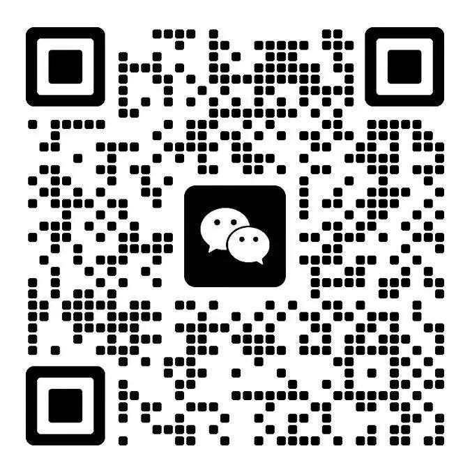

# **省钱兄JAVA和它交朋友项目全套开源系统（JAVA+Uni-app+Vue3）**

**服务端 · 管理端 · 用户端**

八年沉淀，分批次开源由 AI 辅助开发的系统源码。  
开源为生态，服务才是根基。欢迎各位开发者一同交流。

---
⭐ 如果觉得项目不错，请点击右上角 Star 收藏支持！您的 Star 是我们持续开源迭代的最大动力！

## **1. 项目简介**

**省钱兄和它交朋友项目全套开源系统**是一套养宠互动业务系统，采用前后端分离架构，服务端、管理端、用户端全套代码开源。

产品名称是 **和它交朋友**。核心主张是理性养宠、降低遗弃：用户可以按城市找线下门店和小伙伴、发宠物朋友圈、在岛宅里养成虚拟宠物、逛商城，也可以为退役宠物提交领养申请。

服务端基于 **Spring Boot 2.6.11**（**Java 8**）构建，负责接口、数据库，以及支付、短信等外部能力。
管理端基于 **Vue 3** 开发，供平台工作人员在电脑浏览器中审核动态、处理领养、维护门店和商品。
用户端基于 **uni-app** 开发，覆盖手机网页和微信小程序。底部五个入口是 **探索、朋友圈、岛宅、商城、我的**。

本仓库为服务端、管理端、用户端全套源码。

- **官方网站开源计划**：[https://www.xiansqx.com](https://www.xiansqx.com)
- **开源计划**：[https://opensource.xiansqx.cn](https://opensource.xiansqx.cn)
- **官方文档**：[功能说明与运行教程](docs/服务端-运行教程.md)
- **Gitee 仓库**：[https://gitee.com/maxiaodong1996/sqx-chongwufriends.git](https://gitee.com/maxiaodong1996/sqx-chongwufriends.git)
- **GitHub 仓库**：[https://github.com/yuyang7816/sqx-chongwufriends.git](https://github.com/yuyang7816/sqx-chongwufriends.git)

## **2. 移动端界面预览**

下面五张图来自当前项目用户端的真实界面：探索首页、宠物朋友圈、商城、退役领养和我的。

| 探索 | 朋友圈 | 商城 | 退役领养 | 我的 |
| :---: | :---: | :---: | :---: | :---: |
|  |  |  |  |  |

## **3. 开源说明**

> **【省钱兄科技｜开源计划启动】**
>
> 八年沉淀，我们将分批次开源全套由 AI 辅助开发的系统源码。  
> 本项目采用 **Apache 2.0** 许可协议，源码供学习、技术研究、商业使用、二次开发与参考使用。  
> **开源为生态，服务才是根基；** 欢迎各位开发者一同交流。

## **4. 快速开始**

建议顺序：**先服务端，再管理端，最后用户端。** 管理端和用户端都要等服务端已经启动，才能登录和加载数据。

### **4.1 服务端**

安装 JDK 8、Maven、MySQL 5.7 或 8.0、Redis。新建数据库 `chongwujiaopengyou`，导入 [`chongwu-server/sql/pet-full-mysql57.sql`](chongwu-server/sql/pet-full-mysql57.sql)，再启动服务端。  
详细步骤见 [服务端运行教程](docs/服务端-运行教程.md)。

### **4.2 管理端**

安装 Node.js 18 或更高版本，在 `chongwu_admin` 里执行安装并启动。  
详细步骤见 [管理端运行教程](docs/管理端-运行教程.md)。

### **4.3 用户端**

用 HBuilderX 打开 `chongwu-uniapp`，运行到浏览器。  
详细步骤见 [用户端运行教程](docs/用户端-运行教程.md)。

后台演示账号：**admin** / **123456**。  
短信、微信、支付宝等密钥已从开源包中去掉，对应功能需要自行申请。申请入口和官网写在 [用户端功能说明](docs/用户端-功能说明.md) 末尾。

## **5. 文档**

| 想做的事 | 打开哪一份 |
|---|---|
| 把服务端跑起来 | [服务端运行教程](docs/服务端-运行教程.md) |
| 看服务端能做什么 | [服务端功能说明](docs/服务端-功能说明.md) |
| 把管理端跑起来 | [管理端运行教程](docs/管理端-运行教程.md) |
| 看管理端能做什么 | [管理端功能说明](docs/管理端-功能说明.md) |
| 把用户端跑起来 | [用户端运行教程](docs/用户端-运行教程.md) |
| 看用户端能做什么 | [用户端功能说明](docs/用户端-功能说明.md) |

## **6. 目录结构**

仓库根目录只放三端代码、说明和协议。编译出来的 `target`、`dist`、`unpackage`、`node_modules` 是运行时生成的，不需要改。

### **6.1 仓库根目录**

| 路径 | 是什么 |
|---|---|
| `chongwu-server` | **服务端**。接口、数据库脚本、支付和短信等能力都在这里 |
| `chongwu_admin` | **管理端**。工作人员在电脑浏览器里打开的后台 |
| `chongwu-uniapp` | **用户端**。养宠用户用的手机应用，也能在电脑浏览器里看 |
| `docs` | 三端的功能说明和运行教程 |
| `LICENSE` | Apache License 2.0 全文 |

### **6.2 服务端 `chongwu-server`**

| 路径 | 是什么 |
|---|---|
| `sqx-application` | 启动入口。主程序在 `SqxApplication.java`，数据库和 Redis 配置在 `src/main/resources` |
| `sqx-modules/sqx-app` | 养宠业务代码。门店、宠物档案、朋友圈、岛宅、商城、领养、投喂、支付都在 `com.sqx.app.pet` |
| `sqx-modules/sqx-system` | 管理端账号、角色、菜单等系统能力 |
| `sqx-modules/sqx-generator` | 按数据表生成代码的工具，日常运行用不到 |
| `sqx-common/sqx-common-web` | 网页请求、统一异常提示 |
| `sqx-common/sqx-common-mybatis` | 访问 MySQL |
| `sqx-common/sqx-common-redis` | 访问 Redis，记住登录和验证码 |
| `sqx-common/sqx-common-shiro` | 管理端登录和权限 |
| `sqx-common/sqx-common-pay` | 微信支付、支付宝 |
| `sqx-common/sqx-common-sms` | 短信宝、阿里云短信、腾讯云短信 |
| `sqx-common/sqx-common-mail` | 发邮件 |
| `sqx-common/sqx-common-file` | 上传图片。可以存本机硬盘，也可以存阿里云 |
| `sqx-common/sqx-common-doc` | 接口文档页面 |
| `sqx-common/sqx-common-websocket` | 实时消息 |
| `sqx-common/sqx-common-core` | 三端都会用到的公共工具 |
| `sql/pet-full-mysql57.sql` | 首次初始化要导入的完整数据库 |
| `scripts` | 本机导入、同步配置用的脚本 |

### **6.3 管理端 `chongwu_admin`**

| 路径 | 是什么 |
|---|---|
| `src/views/pet` | 宠物业务。城市、门店、档案、社区、岛宅、商城、领养、攻略、打榜都在这里 |
| `src/views/user` | 用户列表、用户详情、认证、注销、消息 |
| `src/views/system` | 系统页面。管理员、角色、菜单、字典、系统配置 |
| `src/views/decoration` | 首页装修和运营展示 |
| `src/views/coupon` | 优惠券制作、发放和核销 |
| `src/views/ranking` | 人气、消费等榜单 |
| `src/views/order` | 订单中心 |
| `src/views/finance` | 财务中心 |
| `src/views/member` | 会员、积分商品和兑换记录 |
| `src/views/LoginView.vue` | 登录页，含验证码 |
| `src/views/DataCenterView.vue` | 登录后的数据统计 |
| `src/api` | 每个页面调用服务端的接口 |
| `src/router` | 页面地址和菜单对应关系 |
| `src/stores` | 登录状态、主题等临时数据 |
| `src/layouts` | 左侧菜单和顶部栏 |
| `src/components` | 上传图片、富文本、分页等共用组件 |
| `src/styles` | 全局样式 |
| `src/utils/tool.js` | 开发时服务端地址 |

### **6.4 用户端 `chongwu-uniapp`**

| 路径 | 是什么 |
|---|---|
| `pages` | 底部五个主入口：探索、朋友圈、岛宅、商城、我的 |
| `packageA/store` | 门店小伙伴 |
| `packageA/archive` | 宠物档案详情 |
| `packageA/adopt` | 退役领养：列表、详情、申请 |
| `packageA/post` | 发布和查看朋友圈动态 |
| `packageA/market` | 宠物集市和兑换记录 |
| `packageA/feed` | 投喂福利 |
| `packageA/tasks` | 任务中心 |
| `packageA/ranking` | 人气打榜 |
| `packageA/strategy` | 养宠攻略 |
| `packageA/product` | 商品详情和下单 |
| `packageA/login` | 登录、注册、找回密码 |
| `packageA/settings` | 资料、协议、注销 |
| `common` | 接口地址、登录、上传图片等公共逻辑 |
| `components` | 页面里重复使用的组件 |
| `static` | 图标、默认图片 |
| `uni_modules` | 界面组件库，其中 **uView Plus** 负责按钮、输入框、轮播 |
| `pages.json` | 有哪些页面、底部导航怎么排 |
| `manifest.json` | 应用名称、微信小程序 AppId |

## **7. 核心特性与技术栈**

### **7.1 核心特性**

· **探索首页按城市看门店、Banner 和社群入口**  
· **宠物朋友圈：发动态、点赞、评论、投诉**  
· **岛宅养成：投喂、任务、集市和常驻宠物**  
· **商城分类、规格下单、积分兑换**  
· **退役宠物领养申请，由后台审核**  
· **人气打榜、养宠攻略**  
· **余额 / 积分 / 微信 / 支付宝付款**  
· **后台审核动态和领养，维护门店、商品和权限**  
· **服务端统一处理登录、订单和支付结果**

每项怎么用，见 [用户端功能说明](docs/用户端-功能说明.md)、[管理端功能说明](docs/管理端-功能说明.md)、[服务端功能说明](docs/服务端-功能说明.md)。

版本以仓库里的配置文件为准。没写死版本号的，按运行教程安装对应大版本即可。

### **7.2 服务端**

| 类别 | 技术 | 版本 | 用来做什么 |
|---|---|---|---|
| 语言 | **Java** | **1.8** | 整个服务端。不能换成 11 或 17 |
| 框架 | **Spring Boot** | **2.6.11** | 提供网页接口，端口 `9294`，路径 `/sqx_fast` |
| 构建 | **Maven** | 3.6 及以上 | 下载依赖、编译、启动 |
| 数据库 | **MySQL** | 5.7 或 8.0 | 业务数据。库名 `chongwujiaopengyou`，脚本是 `sql/pet-full-mysql57.sql` |
| 数据库访问 | **MyBatis-Plus** | 3.5.3.2 | 读写表 |
| 连接池 | **Druid** | 1.2.19 | 管理数据库连接 |
| 缓存 | **Redis**、**Redisson** | Redis 5.0 及以上，Redisson 3.18.0 | 登录状态、验证码 |
| 管理端登录 | **Apache Shiro** | 1.4.0 | 后台账号、角色、菜单权限 |
| 用户端登录 | **JWT**（jjwt） | 0.9.1 | 养宠用户登录后的凭证 |
| 接口文档 | **Knife4j** | 4.4.0 | 浏览器打开 `doc.html` 查看接口 |
| JSON | **Fastjson2** | 2.0.41 | 接口数据格式 |
| 工具库 | **Hutool** | 5.8.16 | 日期、字符串等常用处理 |
| 登录验证码 | **Kaptcha** | 0.0.9 | 管理端登录页上的图片验证码 |
| 对象存储 | **阿里云 OSS SDK** | 3.4.0 | 可选。不填密钥时图片存在本机硬盘 |
| 支付 | 微信支付 SDK、支付宝 SDK | 随支付模块 | 下单、退款。密钥要自己申请 |

### **7.3 管理端**

| 类别 | 技术 | 版本 | 用来做什么 |
|---|---|---|---|
| 运行环境 | **Node.js** | 18 及以上 | 安装依赖、启动开发网站 |
| 页面框架 | **Vue** | 3.5 | 后台每一个页面 |
| 构建 | **Vite** | 5.4 | 开发时热更新，默认端口 `5173` |
| 界面组件 | **Element Plus** | 2.11 | 表格、表单、弹窗、菜单 |
| 页面跳转 | **Vue Router** | 4.5 | 登录页、统计页和各业务页的地址 |
| 状态 | **Pinia** | 3.0 | 记住是否已登录、当前主题 |
| 请求 | **Axios** | 1.9 | 把操作发给服务端 |
| 图表 | **ECharts** | 6.1 | 数据统计页上的图 |
| 样式 | **Sass** | 1.89 | 后台样式 |

### **7.4 用户端**

| 类别 | 技术 | 版本 | 用来做什么 |
|---|---|---|---|
| 框架 | **uni-app** | 用 HBuilderX 打开 | 同一套页面可运行到浏览器、微信小程序 |
| 开发工具 | **HBuilderX** | 正式版 | 编译并运行到 Chrome 或微信开发者工具 |
| 界面组件 | **uView Plus** | 随 `uni_modules` | 按钮、输入框、轮播、弹窗。不负责付款 |
| 浏览器预览 | H5 | 以控制台地址为准 | 电脑上看用户端 |
| 微信小程序 | 微信开发者工具 | 可选 | 要自己的小程序 AppId 才能真机预览 |

## **8. 开源协议**

本仓库使用 **Apache License 2.0**

全文见 [LICENSE](LICENSE)

## **9. 社区与支持**

运行、二次开发或商务合作，可以扫码联系 **省钱兄科技**。

使用过程中如果接口起不来、页面打不开，先按本文 **4. 快速开始** 和 `docs` 里的运行教程排查。短信、微信、支付宝等密钥需要自行申请，申请入口在 [用户端功能说明](docs/用户端-功能说明.md) 末尾。仍解决不了时，再扫下面的码说明你的环境和报错。

当前项目正在测试中，如遇到BUG，可自行修复或者留言反馈，我们将第一时间进行版本迭代。
欢迎一起交流学习。开源是把源码开放出来，具体落地、定制和长期维护仍由服务来承接。

**省钱兄科技**

