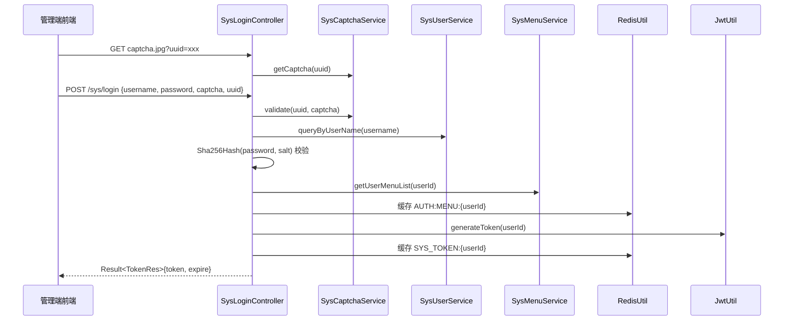
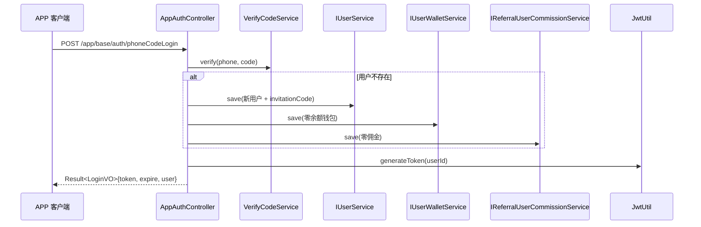
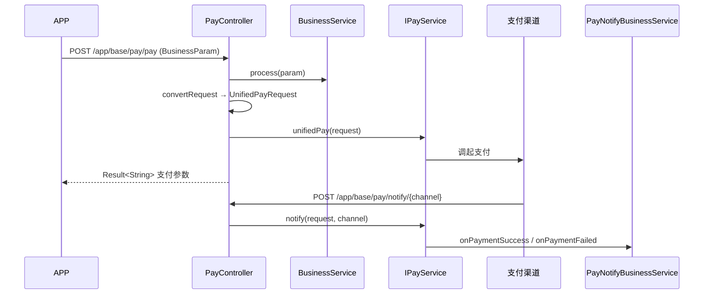

# SQX-Server 项目架构与业务说明书

> **文档版本**：v1.0  
> **项目版本**：0.1  
> **适用对象**：新项目复用、AI 代码生成、团队 onboarding  
> **维护单位**：西安省钱兄网络科技有限公司  
> **最后更新**：2026-05-27  

---

## 目录

1. [项目整体介绍](#1-项目整体介绍)
2. [完整技术栈](#2-完整技术栈)
3. [项目完整目录结构](#3-项目完整目录结构)
4. [所有业务模块介绍](#4-所有业务模块介绍)
5. [核心业务流程](#5-核心业务流程)
6. [实体类 / DO / DTO / VO 设计规范](#6-实体类--do--dto--vo-设计规范)
7. [数据库表结构、关键字段、业务含义](#7-数据库表结构关键字段业务含义)
8. [Controller、Service、Mapper 分层规范](#8-controllerservicemapper-分层规范)
9. [统一返回、全局异常、工具类](#9-统一返回全局异常工具类)
10. [所有接口风格、命名规范](#10-所有接口风格命名规范)
11. [事务、权限、注解规范](#11-事务权限注解规范)
12. [项目可复用的公共逻辑](#12-项目可复用的公共逻辑)
13. [项目开发约定](#13-项目开发约定)
14. [新项目框架说明书（AI 复用指南）](#14-新项目框架说明书ai-复用指南)

---

## 1. 项目整体介绍

### 1.1 项目定位

**sqx-server** 是一套基于 **Spring Boot 2.6.11 + Java 8** 的企业级多模块后端框架，当前业务场景为 **「手办商城系统」（shouban）**。项目采用 **Maven 多模块** 架构，将 **公共能力（sqx-common）**、**业务模块（sqx-modules）**、**启动入口（sqx-application）** 解耦，便于横向扩展新业务域、纵向复用基础设施。

### 1.2 核心能力概览

| 能力域 | 说明 |
|--------|------|
| 管理端 RBAC | 用户 / 角色 / 菜单 / 按钮级权限，Shiro + JWT 无 Session 认证 |
| APP 端用户体系 | 手机号 / 微信登录注册、JWT 鉴权、邀请码裂变 |
| 会员体系 | VIP 套餐、会员特权展示 |
| 钱包体系 | 用户余额、交易流水、管理员调账 |
| 分销 / 佣金 | 邀请关系、佣金汇总、提现申请与审核 |
| 统一支付 | 支付宝 / 微信 / PayPal / Stripe 多渠道抽象 |
| 基础设施 | 文件上传（本地/OSS）、短信、邮件、WebSocket、Redis、API 文档 |

### 1.3 运行入口

- **启动类**：`com.sqx.SqxApplication`
- **模块**：`sqx-application`
- **Context Path**：`/sqx_fast`
- **默认端口**：`9294`（dev 配置，README 中 9690 为历史说明，以 `application.yml` 为准）
- **完整访问前缀**：`http://localhost:9294/sqx_fast`
- **API 文档**：`http://localhost:9294/sqx_fast/doc.html`（Knife4j）
- **默认管理端账号**：`admin` / `123456`

### 1.4 模块依赖关系

```
sqx-application
    └── sqx-app
            ├── sqx-system（系统 RBAC）
            └── sqx-common-*（core / mybatis / shiro / pay / file / sms / mail / doc / websocket / redis）
sqx-generator（独立代码生成器，不参与运行时依赖）
```

### 1.5 双端 API 划分

| 端 | URL 前缀 | 鉴权方式 | 说明 |
|----|----------|----------|------|
| 管理端（后台） | `/sys/**`、`/admin/**` | Shiro JWTFilter + `@RequiresPermissions` | Header: `token` |
| APP 端（C 端） | `/app/**` | Shiro 白名单 + `@Login` 拦截器 | Header: `token`（配置项 `sqx.jwt.header`） |
| 公共 | `/file/**`、`/captcha.jpg`、文档、WebSocket | 部分匿名 | 按 Shiro 白名单配置 |

---

## 2. 完整技术栈

### 2.1 核心框架

| 组件 | 版本 | 用途 |
|------|------|------|
| Java | 8 | 语言运行时 |
| Spring Boot | 2.6.11 | 应用框架 |
| Maven | 3.8+ | 构建与依赖管理 |

### 2.2 持久层

| 组件 | 版本 | 用途 |
|------|------|------|
| MyBatis Plus | 3.5.3.2 | ORM、分页、逻辑删除、字段填充 |
| MySQL Connector | 8.3.0 | 数据库驱动 |
| Druid | 1.2.19 | 连接池、SQL 监控（`/druid/*`） |
| MyBatis Plus Generator | 3.5.7 | 代码生成器 |

**MyBatis Plus 全局配置要点**（`application.yml`）：

- `mapper-locations`: `classpath*:/mapper/**/*.xml`
- `typeAliasesPackage`: `com.sqx.modules.*.entity`（历史配置，实际实体分布在 `com.sqx.*`）
- 主键策略：`AUTO`
- 逻辑删除：`logic-delete-value: -1`，`logic-not-delete-value: 0`
- 字段策略：`not_empty`（insert/update/select）
- 下划线转驼峰：开启
- SQL 日志：`StdOutImpl`（开发环境）

### 2.3 缓存与分布式

| 组件 | 版本 | 用途 |
|------|------|------|
| Redis | 5.0+ | Token 缓存、配置缓存 |
| Redisson | 3.18.0 | 分布式锁 / Redis 客户端 |

配置开关：`sqx.redis.open: false`（可按环境启用）

### 2.4 安全认证

| 组件 | 版本 | 用途 |
|------|------|------|
| Apache Shiro | 1.4.0 | 管理端认证授权 |
| JWT (jjwt) | 0.9.1 | Token 生成与解析 |
| java-jwt (Auth0) | 3.8.3 | 苹果登录等扩展场景 |
| Kaptcha | 0.0.9 | 图形验证码 |

JWT 配置：

```yaml
sqx:
  jwt:
    secret: f4e2e52034348f86b67cde581c0f9eb5
    expire: 2592000        # 30 天，单位秒
    header: token          # 请求头名称
```

### 2.5 API 文档

| 组件 | 用途 |
|------|------|
| SpringDoc OpenAPI 3 | `/v3/api-docs` |
| Knife4j | 增强 UI，`/doc.html` |

文档分组：

- 业务模块 - 管理端：`/admin/**`
- 业务模块 - APP 端：`/app/**`
- 系统模块：`com.sqx.system`
- API：全局

### 2.6 支付集成

| 渠道 | 实现位置 |
|------|----------|
| 支付宝 | `sqx-common-pay/channel/ali` |
| 微信支付 | `sqx-common-pay/channel/wechat` |
| PayPal | `sqx-common-pay/channel/paypal` |
| Stripe | `sqx-common-pay/channel/stripe` |

### 2.7 文件存储

| 实现 | 类 |
|------|-----|
| 本地存储 | `LocalFileStorage` |
| 宝塔本地 | `BTLocalFileStorage` |
| 阿里云 OSS | `AliOssFileStorage` |

### 2.8 通信与其他

| 组件 | 版本 | 用途 |
|------|------|------|
| Jakarta Mail | - | 邮件发送 |
| 短信（DXB 等） | - | `sqx-common-sms` |
| WebSocket | - | `sqx-common-websocket` |
| OkHttp | 4.12.0 | HTTP 客户端 |
| Hutool | 5.8.16 | 工具集 |
| Fastjson2 | 2.0.41 | JSON 序列化 |
| Gson | 2.10.1 | 日志切面参数序列化 |
| Commons Lang3 | 3.12.0 | 字符串 / 工具 |
| Commons Collections4 | 4.4 | 集合工具 |
| Commons IO | 2.13.0 | IO 工具 |
| ZXing | 3.5.3 | 二维码 |
| Oshi | 6.6.5 | 系统信息 |
| Joda Time | 2.9.9 | 时间处理 |
| HttpClient | 4.5.14 | HTTP |
| Aliyun OSS SDK | 3.4.0 | 对象存储 |

### 2.9 数据库

- **引擎**：MySQL 8.0+
- **开发库名**：`shouban`（`application-dev.yml`）
- **连接示例**：`jdbc:mysql://127.0.0.1:3306/shouban?useUnicode=true&characterEncoding=utf-8&useSSL=false`

---

## 3. 项目完整目录结构

### 3.1 顶层结构

```text
sqx-server/
├── pom.xml                          # 父 POM，统一版本与 dependencyManagement
├── README.md                        # 项目说明
├── project-architecture-doc.md      # 本文档
├── sqx-application/                 # 【启动模块】Fat Jar 打包入口
├── sqx-common/                      # 【公共组件】可复用基础设施
│   ├── sqx-common-bom/              # BOM 依赖管理
│   ├── sqx-common-core/             # 核心：Result、异常、工具、校验
│   ├── sqx-common-web/              # Web：全局异常、CORS、Filter
│   ├── sqx-common-mybatis/          # MyBatis Plus 配置、分页工具
│   ├── sqx-common-shiro/            # Shiro + JWT 安全框架
│   ├── sqx-common-redis/            # Redis / Redisson / ConfigUtil
│   ├── sqx-common-pay/              # 统一支付
│   ├── sqx-common-file/             # 文件存储抽象
│   ├── sqx-common-sms/              # 短信
│   ├── sqx-common-mail/             # 邮件
│   ├── sqx-common-doc/              # SpringDoc / Knife4j 配置
│   └── sqx-common-websocket/        # WebSocket
└── sqx-modules/                     # 【业务模块组】
    ├── sqx-system/                  # 系统管理 RBAC
    ├── sqx-app/                     # APP / 管理端业务
    └── sqx-generator/               # MyBatis Plus 代码生成器
```

### 3.2 sqx-application 职责

| 路径 | 职责 |
|------|------|
| `com.sqx.SqxApplication` | Spring Boot 启动类，`@MapperScan` 扫描 system + app 的 mapper |
| `com.sqx.runner.SqxApplicationRunner` | 启动后初始化逻辑 |
| `resources/application.yml` | 主配置 |
| `resources/application-dev.yml` | 开发环境数据源、Redisson |
| `resources/application-prod.yml` | 生产环境配置 |
| `resources/logback.xml` | 日志配置 |

### 3.3 sqx-common 各子模块职责

#### sqx-common-core

| 包 / 类 | 职责 |
|---------|------|
| `domain.Result` | 统一 API 返回体 |
| `enums.SystemErrorCode` / `IErrorCode` | 系统级错误码 |
| `exception.BizException` | 业务异常（带 IErrorCode） |
| `exception.SqxException` | 通用异常（自定义 code + message） |
| `exception.PayException` | 支付异常 |
| `constant.Constant` | 全局常量（SUPER_ADMIN、MenuType） |
| `validator.*` | JSR303 校验工具、分组（AddGroup/UpdateGroup 等） |
| `utils.*` | DateUtils、Md5Utils、GenUtil、OkHttpUtil、SpringContextHolder |
| `config.KaptchaConfig` | 验证码 Bean |
| `config.ThreadPoolConfig` | 线程池 |
| `event.*` | 事件抽象基类 |

#### sqx-common-web

| 类 | 职责 |
|----|------|
| `GlobalExceptionHandler` | 全局异常 → Result |
| `CorsConfig` | 跨域 |
| `FilterConfig` | 过滤器注册 |
| `HttpContextUtil` | 获取当前 HttpServletRequest |
| `IPUtils` | 客户端 IP 解析 |

#### sqx-common-mybatis

| 类 | 职责 |
|----|------|
| `MybatisPlusConfig` | 分页插件、事务、`MetaObjectHandler` |
| `CustomMetaObjectHandler` | 自动填充 `createTime` / `updateTime` |
| `PageUtil` | 分页初始化、Entity Page → VO Page 拷贝 |
| `PageUtils` / `Query` | system 模块旧版分页（Map 参数） |
| `PageParam` | 分页 BO 基类（page、limit） |
| `SQLFilter` | SQL 注入过滤 |

#### sqx-common-shiro

| 类 | 职责 |
|----|------|
| `ShiroConfig` | Shiro 过滤器链、SecurityManager、无 Session |
| `JWTFilter` | 管理端 JWT 认证过滤器 |
| `JWTRealm` | 认证 + 授权（权限字符串） |
| `JwtUtil` | JWT 生成 / 校验 / 过期判断 |
| `ShiroService` | 查询用户权限集合 |
| `IShiroUserService` | 加载 AuthUser（由 SysUserServiceImpl 实现） |
| `AuthUser` / `AuthSysMenu` | 认证用户 / 菜单模型 |
| `UserContextHolder` | 从 Request 获取 APP 用户 ID |
| `ShiroConstant` | Redis Key 模板 |
| `ShiroExceptionHandler` | Shiro 异常处理 |

#### sqx-common-redis

| 类 | 职责 |
|----|------|
| `RedisUtil` | Redis 缓存 CRUD |
| `ConfigUtil` | 从 Redis / DB 读取 sys_config |

#### sqx-common-pay

| 包 | 职责 |
|----|------|
| `service.IPayService` | 统一支付 / 退款 / 回调 |
| `factory.PayOperationFactory` | 支付渠道工厂 |
| `operation.IPayOperation` | 渠道操作接口 |
| `channel/ali` | 支付宝 |
| `channel/wechat` | 微信支付 |
| `channel/paypal` | PayPal |
| `channel/stripe` | Stripe |
| `notify.*` | 回调处理器与业务接口 |
| `domain.UnifiedPayRequest` | 统一支付请求 |
| `enums.PayChannel` / `PayTradeType` | 渠道与交易类型枚举 |

#### sqx-common-file

| 类 | 职责 |
|----|------|
| `factory.FileStorageFactory` | 存储策略工厂 |
| `storage.*` | 本地 / OSS 实现 |
| `config.FileAutoConfiguration` | 自动配置 |

#### sqx-common-sms / mail / doc / websocket

- **sms**：短信 Provider 工厂、DXB 实现
- **mail**：邮件服务接口与实现
- **doc**：SpringDoc 属性与分组配置
- **websocket**：Session 持有者、WebSocket 配置

### 3.4 sqx-modules/sqx-system 包结构

```text
com.sqx.system/
├── aspect/                    # AOP 切面
│   ├── SysLogAspect.java      # 操作日志切面
│   └── annotation/SysLog.java
├── controller/                # 管理端 Controller（/sys/**）
│   ├── AbstractController.java
│   ├── SysLoginController.java
│   ├── SysUserController.java
│   ├── SysRoleController.java
│   ├── SysMenuController.java
│   ├── SysConfigController.java
│   ├── SysDictController.java
│   └── SysLogController.java
├── service/                   # 【业务 Service 层】
│   └── impl/
├── db/                        # 【数据访问层】
│   ├── entity/                # 数据库实体
│   ├── mapper/                # MyBatis Mapper（命名 *Dao）
│   └── service/               # MyBatis Plus IService（命名 I*Service）
│       └── impl/              # I*ServiceImpl
├── domain/
│   ├── form/                  # 请求表单（如 SysLoginForm）
│   └── res/                   # 响应对象（如 SysUserRes、TokenRes）
└── resources/mapper/          # XML Mapper
```

### 3.5 sqx-modules/sqx-app 包结构（业务域驱动）

每个业务子域遵循 **相同垂直分层**：

```text
com.sqx.app.{domain}/
├── controller/
│   ├── App*Controller.java      # C 端 /app/**
│   └── Admin*Controller.java    # 管理端 /admin/**
├── service/                     # 业务逻辑层
│   └── impl/
├── db/
│   ├── mapper/                  # *Mapper 接口
│   └── service/                 # I*Service（MP ServiceImpl）
│       └── impl/
├── domain/
│   ├── entity/                  # 数据库实体
│   ├── bo/                      # 请求 BO（SaveBo/PageBo/InfoBo/UpdateBo）
│   └── vo/                      # 响应 VO
├── enums/                       # 域内枚举（可选）
└── constants/                   # 域内常量（可选）
```

**base 子模块**（公共 APP 能力）：

```text
com.sqx.app.base/
├── auth/                        # 登录注册、JWT 拦截器
│   ├── auth/
│   │   ├── annotation/Login.java、LoginUser.java
│   │   ├── interceptor/AuthorizationInterceptor.java
│   │   ├── resolver/LoginUserHandlerMethodArgumentResolver.java
│   │   └── config/WebMvcConfig.java
│   ├── controller/AppAuthController.java
│   ├── service/AppAuthService.java
│   └── domain/bo、domain/vo
├── user/                        # C 端用户
├── pay/                         # 统一支付入口
├── verifyCode/                  # 短信 / 邮箱验证码
├── messages/                    # 消息通知
├── banner/                      # Banner（复用 system 的 Banner 实体）
├── file/                        # 文件上传 Controller
├── map/                         # 地图逆地理编码
├── appConfig/                   # APP 配置读取
├── template/                    # 短信模板管理
├── constants/BaseConstant.java  # /app/base、/admin/base 前缀
├── enums/AppError.java          # APP 业务错误码
└── utils/                       # 微信、地图、请求工具
```

**其他业务域**：

```text
com.sqx.app/
├── wallet/
│   ├── wallet/                  # 用户钱包
│   └── transaction/             # 钱包流水
├── vip/
│   ├── plan/                    # 会员套餐
│   └── rights/                  # 会员特权
└── referral/
    ├── commission/              # 佣金明细
    ├── user/                    # 用户佣金汇总
    └── withdraw/                # 提现账号 + 提现记录
```

### 3.6 sqx-generator 职责

- 基于 MyBatis Plus Generator 3.5.7
- 自定义 Velocity 模板（`resources/templates/`）
- 生成标准分层：`entity`、`bo`、`vo`、`db.mapper`、`db.service`、`service`、`controller`
- 输出目录默认指向 `sqx-modules/sqx-app`

---

## 4. 所有业务模块介绍

### 4.1 sqx-system — 系统管理模块

| 子功能 | 说明 | 核心类 |
|--------|------|--------|
| 登录 / 登出 | 图形验证码 + 用户名密码 + JWT | `SysLoginController` |
| 用户管理 | CRUD、改密、角色绑定 | `SysUserController`、`SysUserServiceImpl` |
| 角色管理 | CRUD、菜单授权 | `SysRoleController`、`SysRoleServiceImpl` |
| 菜单管理 | 树形菜单、导航、按钮权限 | `SysMenuController`、`SysMenuServiceImpl` |
| 系统配置 | Key-Value 参数，支持 refresh | `SysConfigController` |
| 数据字典 | 类型 + 码值管理，逻辑删除 | `SysDictController` |
| 操作日志 | AOP 自动记录 | `SysLogController`、`SysLogAspect` |
| 验证码 | 图形验证码生成与校验 | `SysCaptchaService` |
| Banner | 轮播图 / 金刚区（与 app 共用表） | `Banner`、`IBannerService` |

**RBAC 模型**：

- `sys_user` ↔ `sys_user_role` ↔ `sys_role` ↔ `sys_role_menu` ↔ `sys_menu`
- 菜单 `type`：0 目录 / 1 菜单 / 2 按钮
- 按钮权限字符串格式：`sys:user:list`（存储在 `sys_menu.perms`）

### 4.2 sqx-app/base — 基础 APP 能力

| 子模块 | 业务说明 |
|--------|----------|
| **auth** | 手机号密码登录、验证码登录（未注册自动注册）、注册、重置密码、微信小程序登录 / 注册、解密手机号 |
| **user** | C 端用户信息查询与修改、管理端用户列表 |
| **verifyCode** | 发送手机 / 邮箱验证码，验证码校验与过期 |
| **pay** | 统一支付入口、支付回调、业务类型分发（当前 VIP 占位） |
| **messages** | 系统公告与用户消息（已读未读） |
| **banner** | APP 端 Banner 分页、管理端 CRUD |
| **file** | 文件上传（匿名白名单 `/file/upload`） |
| **map** | 逆地理编码 |
| **appConfig** | 读取 APP 端配置项 |
| **template** | 短信模板 CRUD（按 biz_code 区分业务） |

### 4.3 sqx-app/wallet — 钱包模块

| 子模块 | 业务说明 |
|--------|----------|
| **wallet** | 用户钱包主表，余额查询；管理员可手动增减余额并记流水 |
| **transaction** | 钱包交易流水：充值、消费、退款、系统调整、退保证金等 |

**交易类型（transaction_type）**：1 充值 / 2 消费 / 3 退款 / 5 系统调整 / 6 退保证金  
**业务类型（biz_type）**：1 会员购买 / 2 订单支付 / 3 活动奖励 / 5 退款 / 6 退保证金  
**资金流向（direction）**：1 收入 / 2 支出

### 4.4 sqx-app/vip — 会员模块

| 子模块 | 业务说明 |
|--------|----------|
| **plan** | 会员套餐：名称、月数、价格、原价、排序；APP 列表 + 管理端 CRUD |
| **rights** | 会员特权：图标、名称、排序；APP 列表 + 管理端 CRUD |

用户表 `tb_user.is_vip` / `user_type` 标识会员状态，支付回调业务可扩展开通会员逻辑。

### 4.5 sqx-app/referral — 分销 / 佣金模块

| 子模块 | 业务说明 |
|--------|----------|
| **user** | 用户佣金余额汇总；邀请数据统计、下级用户列表、推广律师信息 |
| **commission** | 佣金明细流水（订单佣金 / 提现扣减 / 拒绝退回） |
| **withdraw** | 提现账号绑定（微信 / 支付宝）；提现申请、审核确认 / 拒绝 |

**邀请机制**：

- 用户注册时生成 `invitation_code`（基于手机号）
- 注册可填写 `superior_invitation_code` 绑定上级
- 佣金比例配置键：`biz_referral_commission_rate`（sys_config）
- 提现配置键：`sys_withdraw_max/min/rate`

### 4.6 sqx-generator — 代码生成器

- 一键生成符合本项目规范的 CRUD 全套代码
- 生成 Admin + App 双 Controller 模板（可配置）
- 生成 SaveBo / UpdateBo / PageBo / InfoBo / Vo

---

## 5. 核心业务流程

### 5.1 管理端登录流程



**密码规则**：`Sha256Hash(plainPassword, salt).toHex()`，salt 为 20 位随机字符串。

**后续请求**：

1. Header 携带 `token`
2. `JWTFilter` → `JWTRealm.doGetAuthenticationInfo` 校验 JWT + Redis 中 token 是否存在
3. `JWTRealm.doGetAuthorizationInfo` 加载 `sys:user:*` 等权限字符串
4. Controller 方法 `@RequiresPermissions` 鉴权

### 5.2 APP 端登录 / 注册流程



**密码规则（APP）**：`Md5Utils.md5s(password)`，与管理端不同。

**鉴权机制**：

- Shiro 对 `/app/**` 配置为 `anon`（不过 Shiro JWT）
- 需要登录的接口标注 `@Login`
- `AuthorizationInterceptor` 拦截 `/app/**`，校验 JWT，将 `userId` 写入 Request
- 可通过 `@LoginUser` 参数注入当前用户（配合 `LoginUserHandlerMethodArgumentResolver`）
- 或通过 `UserContextHolder.getAppUserId()` 获取

### 5.3 微信小程序登录流程

1. `GET /app/base/auth/wxLogin?code=xxx` → 调用微信 `jscode2session`
2. 若 openId 未绑定手机号 → 返回 `bindPhone=false` + sessionKey
3. 若已绑定 → 返回 `LoginVO` 直接登录
4. `POST /app/base/auth/wxJsRegister` → 绑定手机号并完成注册（含 registerBiz）
5. `GET /app/base/auth/getWxUserPhoneNumber` → 新版获取手机号

### 5.4 统一支付流程



**BusinessParam 关键字段**：`businessType`、`tradeType`、`amount`、`channel`、`redirectUri`、`openId`、`orderNo`

**BusinessType 枚举**：`vip`（会员，可扩展）

**回调 URL 规则**：`{domain}/app/base/pay/notify/{channel}`

> 当前 `BusinessServiceImpl.process` 与 `PayNotifyBusinessServiceImpl` 为占位实现，新业务需在回调中完成订单 / 会员 / 钱包状态变更。

### 5.5 钱包调账流程（管理端）

1. `POST /admin/userWallet/updateAmount`
2. 根据 `operator`（INCR/DECR）调用 `IUserWalletService.incr/decr`
3. 同步写入 `user_wallet_transaction` 流水记录

### 5.6 提现流程

**用户发起**（`POST /app/withdrawRecord/save`，需 `@Login`）：

1. 校验 `referral_user_commission.commission` 余额充足
2. 读取 sys_config：`sys_withdraw_max`、`sys_withdraw_min`、`sys_withdraw_rate`
3. 计算手续费与实际到账金额
4. 保存 `withdraw_record`（status=1 发起提现）
5. `referral_user_commission` 扣减佣金
6. `referral_commission` 写入提现支出明细

**管理员审核**（`POST /admin/withdrawRecord/confirm`）：

- status=2：提现成功，记录 `withdraw_time`
- status=3：拒绝提现，退回佣金到 `referral_user_commission`，写入拒绝明细

### 5.7 RBAC 权限加载流程

1. 用户登录后缓存菜单 JSON 到 Redis：`AUTH:MENU:{userId}`
2. 每次鉴权时 `ShiroService.getUserPermissions(userId)` 查询所有 `perms`
3. 超级管理员 ID = 1（`Constant.SUPER_ADMIN`）拥有全部权限
4. 非超管只能操作自己创建的角色（`checkRole` 防越权）

### 5.8 操作日志流程

1. Controller 方法标注 `@SysLog("操作描述")`
2. `SysLogAspect` 环绕通知记录：操作、方法、参数 JSON、IP、用户名、耗时
3. 持久化到 `sys_log`

---

## 6. 实体类 / DO / DTO / VO 设计规范

### 6.1 命名约定总表

| 类型 | system 模块 | app 模块 | 说明 |
|------|-------------|----------|------|
| 数据库实体 | `*Entity` 或 plain name | 类名与表语义一致（如 `UserWallet`） | 放 `db/entity` 或 `domain/entity` |
| 请求入参 | `*Form` | `*Bo`（SaveBo/PageBo/InfoBo/UpdateBo） | BO = Business Object |
| 响应出参 | `*Res` | `*Vo` | VO = View Object |
| 认证模型 | - | `*VO`（LoginVO） | 登录专用 |

### 6.2 Entity 规范

**通用注解**：

```java
@Data / @Getter @Setter
@TableName("table_name")
@Schema(description = "...")           // app 模块实体
@TableId(type = IdType.AUTO)           // 自增主键
@TableField(value = "column_name")     // 显式列映射
@TableField(exist = false)              // 非数据库字段
@TableLogic                             // 逻辑删除（system 字典）
@TableField(fill = FieldFill.INSERT)    // createTime 自动填充
@TableField(fill = FieldFill.UPDATE)    // updateTime 自动填充
@JsonFormat(pattern = "yyyy-MM-dd HH:mm:ss")
```

**时间类型**：

- app 模块：`LocalDateTime`
- system 模块部分实体：`Date`

**主键策略**：

- 默认 `IdType.AUTO`
- 验证码表 `verify_code` 使用 `IdType.ASSIGN_ID`

### 6.3 BO 规范

**SaveBo**：新增  
**UpdateBo**：修改（含 id）  
**InfoBo**：详情 / 删除（通常仅 id）  
**PageBo**：分页查询，继承 `PageParam`

```java
@Data
@EqualsAndHashCode(callSuper = true)
public class XxxPageBo extends PageParam {
    // 筛选字段
}
```

`PageParam` 字段：`page`（默认 1）、`limit`（默认 10）

**校验**：Controller 层使用 `@Validated` + JSR303 注解；system 模块使用分组 `@Validated(AddGroup.class)`

### 6.4 VO / Res 规范

- 仅包含前端需要的字段
- 可嵌套关联对象（如 `WithdrawRecordVo` 含 `UserEntity`、`WithdrawalAccount`）
- 列表分页返回：`Result<IPage<XxxVo>>`

### 6.5 system 模块 Form / Res 示例

- `SysLoginForm`：username、password、captcha、uuid
- `TokenRes`：token、expire
- `SysUserRes`、`SysRoleRes`、`SysMenuRes`、`SysNavRes`、`SysDictRes`、`SysConfigRes`

### 6.6 不使用的命名

- 本项目 **不使用 DTO 命名**（用 Bo / Form 代替）
- 本项目 **不使用 DO 命名**（Entity 即 DO）
- app 模块 **不使用 Req/Res**（使用 Bo/Vo）

---

## 7. 数据库表结构、关键字段、业务含义

### 7.1 系统表（sys_*）

#### sys_user — 系统用户

| 字段 | 类型 | 含义 |
|------|------|------|
| user_id | BIGINT PK | 用户 ID |
| username | VARCHAR | 登录用户名 |
| password | VARCHAR | Sha256 加密密码 |
| salt | VARCHAR | 密码盐（20 位） |
| email | VARCHAR | 邮箱 |
| mobile | VARCHAR | 手机号 |
| status | INT | 0 禁用 / 1 正常 |
| create_user_id | BIGINT | 创建者 |
| create_time | DATETIME | 创建时间 |
| inviter_code | VARCHAR | 邀请码（扩展） |

#### sys_role — 角色

| 字段 | 含义 |
|------|------|
| role_id | 角色 ID |
| role_name | 角色名称 |
| remark | 备注 |
| create_user_id | 创建者 |
| create_time | 创建时间 |

#### sys_menu — 菜单 / 权限

| 字段 | 含义 |
|------|------|
| menu_id | 菜单 ID |
| parent_id | 父 ID，根为 0 |
| name | 菜单名称 |
| url | 路由 URL |
| perms | 权限标识，如 `sys:user:list` |
| type | 0 目录 / 1 菜单 / 2 按钮 |
| icon | 图标 |
| order_num | 排序 |

#### sys_user_role — 用户角色关联

| 字段 | 含义 |
|------|------|
| id | 主键 |
| user_id | 用户 ID |
| role_id | 角色 ID |

#### sys_role_menu — 角色菜单关联

| 字段 | 含义 |
|------|------|
| id | 主键 |
| role_id | 角色 ID |
| menu_id | 菜单 ID |

#### sys_config — 系统配置

| 字段 | 含义 |
|------|------|
| id | 主键 |
| param_key | 配置键 |
| param_value | 配置值 |
| status | 状态 |
| remark | 备注 |
| param_type | 参数类型 |
| param_type_desc | 类型描述 |

**常用配置键**：

| param_key | 用途 |
|-----------|------|
| sys_withdraw_max | 最大提现金额 |
| sys_withdraw_min | 最小提现金额 |
| sys_withdraw_rate | 提现手续费率 |
| biz_referral_commission_rate | 分销佣金比例 |
| pay_wx_jsapi_app_id 等 | 支付相关 |
| sys_user_ma_appid / secret | 微信小程序 |

#### sys_dict — 数据字典

| 字段 | 含义 |
|------|------|
| id | 主键 |
| name | 字典名称 |
| type | 字典类型 |
| code | 字典码 |
| value | 字典值 |
| order_num | 排序 |
| remark | 备注 |
| del_flag | 逻辑删除 -1 删除 / 0 正常 |

#### sys_log — 操作日志

| 字段 | 含义 |
|------|------|
| id | 主键 |
| username | 操作人 |
| operation | 操作描述 |
| method | 方法签名 |
| params | 请求参数 JSON |
| time | 耗时 ms |
| ip | IP 地址 |
| create_date | 创建时间 |

#### sys_captcha — 图形验证码

| 字段 | 含义 |
|------|------|
| uuid | 验证码唯一标识 |
| code | 验证码值 |
| expire_time | 过期时间 |

#### sys_user_token — 用户 Token（历史表，当前主要用 Redis）

| 字段 | 含义 |
|------|------|
| user_id | 用户 ID |
| token | Token 字符串 |
| expire_time | 过期时间 |
| update_time | 更新时间 |

#### banner — 轮播图

| 字段 | 含义 |
|------|------|
| id | 主键 |
| name | 名称 |
| image_url | 图片地址 |
| classify | 1 Banner 图 / 2 金刚区 |
| url | 跳转地址 |
| sort | 排序 |
| description | 描述 |
| state | 1 正常 / 2 隐藏 |
| create_time / update_time | 时间戳 |

### 7.2 APP 业务表

#### tb_user — C 端用户

| 字段 | 含义 |
|------|------|
| user_id | 用户 ID |
| user_name | 用户名 |
| phone | 手机号 |
| avatar | 头像 |
| sex | 1 男 / 2 女 |
| age | 年龄 |
| ma_open_id | 小程序 openId |
| mp_open_id | 公众号 openId |
| password | MD5 密码 |
| apple_id | Apple 登录 ID |
| sys_phone | 1 安卓 / 2 iOS |
| status | 1 正常 / 2 禁用 |
| platform | 来源：app / 小程序 / 公众号 |
| cid | APP 推送 ID |
| user_type | 1 普通 / 2 VIP |
| is_vip | 0 否 / 1 是 |
| invitation_code | 自己的邀请码 |
| superior_invitation_code | 上级邀请码 |
| create_time / update_time | 时间戳 |

#### verify_code — 短信验证码

| 字段 | 含义 |
|------|------|
| id | 主键（ASSIGN_ID） |
| phone | 手机号 |
| code | 验证码 |
| status | 1 未使用 / 2 已使用 |
| expire_time | 过期时间 |
| create_time | 创建时间 |

#### sms_template — 短信模板

| 字段 | 含义 |
|------|------|
| id | 主键 |
| biz_code | 业务标识 login / register 等 |
| content | 模板内容 |
| create_time / update_time | 时间戳 |

#### messages — 消息

| 字段 | 含义 |
|------|------|
| id | 主键 |
| title | 标题 |
| content | 内容 |
| image_urls | 图片 URL（逗号分隔） |
| url | 跳转链接 |
| type | 1 系统公告 / 2 用户消息 |
| user_id | 接收用户 |
| data_id | 关联业务 ID |
| is_read | 0 未读 / 1 已读 |
| create_time / update_time | 时间戳 |

#### user_wallet — 用户钱包

| 字段 | 含义 |
|------|------|
| id | 钱包 ID |
| user_id | 用户 ID（唯一） |
| amount | 余额（元） |
| create_time / update_time | 时间戳 |

#### user_wallet_transaction — 钱包流水

| 字段 | 含义 |
|------|------|
| id | 流水 ID |
| user_id | 用户 ID |
| transaction_type | 1 充值 / 2 消费 / 3 退款 / 5 系统调整 / 6 退保证金 |
| amount | 金额（正数） |
| direction | 1 收入 / 2 支出 |
| biz_type | 1 会员 / 2 订单 / 3 活动 / 5 退款 / 6 退保证金 |
| biz_id | 关联业务 ID |
| status | 1 待处理 / 2 完成 / 3 取消 / 4 失败 |
| title / description | 标题 / 描述 |
| extra_data | 扩展 JSON |
| create_time / update_time | 时间戳 |

#### vip_plan — 会员套餐

| 字段 | 含义 |
|------|------|
| id | 主键 |
| name | 套餐名称 |
| month | 月数 |
| amount | 售价 |
| original_amount | 原价 |
| sort | 排序 |
| create_time / update_time | 时间戳 |

#### vip_rights — 会员特权

| 字段 | 含义 |
|------|------|
| id | 主键 |
| img | 图标 |
| name | 名称 |
| sort | 排序 |
| create_time / update_time | 时间戳 |

#### referral_user_commission — 用户佣金汇总

| 字段 | 含义 |
|------|------|
| id | 主键 |
| user_id | 用户 ID |
| commission | 可提现佣金余额 |

#### referral_commission — 佣金明细

| 字段 | 含义 |
|------|------|
| id | 主键 |
| user_id | 用户 ID |
| order_id | 订单 ID |
| rate | 佣金比例 |
| amount | 佣金金额 |
| type | 0 提现 / 1 订单佣金 |
| direction | 1 收入 / 2 支出 |
| title / description | 标题 / 描述 |
| create_time / update_time | 时间戳 |

#### withdrawal_account — 提现账号

| 字段 | 含义 |
|------|------|
| id | 主键 |
| user_id | 用户 ID |
| account_name | 账户名称 |
| account_number | 账号 |
| type | 1 支付宝 / 2 微信 |
| create_time / update_time | 时间戳 |

#### withdraw_record — 提现记录

| 字段 | 含义 |
|------|------|
| id | 主键 |
| user_id | 用户 ID |
| amount | 申请金额 |
| actual_amount | 实际到账 |
| service_fee | 手续费 |
| account_type | 1 微信 / 2 支付宝 |
| status | 1 发起 / 2 成功 / 3 拒绝 |
| reason | 拒绝理由 |
| withdraw_time | 转账时间 |
| create_time / update_time | 时间戳 |

---

## 8. Controller、Service、Mapper 分层规范

### 8.1 三层 + 双 Service 模式

本项目采用 **「Controller → 业务 Service → DB Service → Mapper」** 四层结构：

```
Controller
    ↓ 调用
XxxService / XxxServiceImpl        ← 业务逻辑、事务、BO/VO 转换
    ↓ 调用
IXxxService / IXxxServiceImpl      ← MyBatis Plus ServiceImpl，纯 CRUD + 简单 SQL
    ↓ 调用
XxxMapper / XxxDao                   ← MyBatis Mapper 接口
    ↓
XML Mapper（复杂 SQL）
```

**命名差异**：

| 模块 | Mapper 命名 | DB Service 命名 |
|------|-------------|-----------------|
| sqx-system | `*Dao` | `ISys*Service` / `ISys*ServiceImpl` |
| sqx-app | `*Mapper` | `I*Service` / `I*ServiceImpl` |

### 8.2 Controller 规范

**职责**：参数接收、校验触发、调用 Service、包装 Result，**不写业务逻辑**。

**system 模块**：

- 继承 `AbstractController` 获取 `getUser()` / `getUserId()`
- 使用 `@RequiresPermissions("sys:xxx:yyy")`
- RESTful 风格混合：GET 查询 + POST 写操作

**app 模块**：

- 双 Controller：`App*Controller` + `Admin*Controller`
- 管理端路径：`/admin/{moduleName}`
- APP 路径：`/app/{moduleName}` 或 `/app/base/{feature}`
- 需登录接口：`@Login` + 可选 `@LoginUser UserEntity user`
- 统一返回：`Result<T>`

**典型 CRUD Controller 方法集**：

| 方法 | 路径 | 说明 |
|------|------|------|
| save | POST save | 新增 |
| page | POST page | 分页列表 |
| info | POST info | 详情 |
| update | POST update | 修改 |
| delete | POST delete | 删除 |

### 8.3 业务 Service 规范

**接口命名**：`XxxService`  
**实现命名**：`XxxServiceImpl`  
**方法命名**：

| 方法 | 用途 |
|------|------|
| saveInfo | 新增 |
| pageInfo | 分页 |
| info | 详情 |
| updateInfo | 更新 |
| delete | 删除 |

**典型实现模式**：

1. BO → Entity（`BeanUtils.copyProperties`）
2. 调用 `I*Service` 完成持久化
3. Entity → VO 返回
4. 分页：`PageUtil.initPage` → query → `PageUtil.copyPage`
5. 业务校验失败：`throw new BizException("...")` 或 `throw new BizException(AppError.XXX)`

### 8.4 DB Service 规范

- 继承 `ServiceImpl<Mapper, Entity>` 并实现 `I*Service extends IService<Entity>`
- 仅负责单表 CRUD 及简单条件查询
- 可扩展原子操作：`incr`、`decr`、`getByUserId` 等
- **不在此层写跨表业务**

### 8.5 Mapper 规范

- 接口加 `@Mapper` 或在启动类 `@MapperScan`
- 复杂 SQL 写 XML，位于 `resources/mapper/`
- system 模块 XML 命名：`SysUserDao.xml`
- app 模块 XML 命名：`UserMapper.xml`

---

## 9. 统一返回、全局异常、工具类

### 9.1 Result 统一返回

```json
{
  "code": 0,
  "msg": "操作成功",
  "data": { }
}
```

**工厂方法**：

| 方法 | 场景 |
|------|------|
| `Result.success()` | 无数据成功 |
| `Result.success(data)` | 带数据成功 |
| `Result.success(data, message)` | 带数据和消息 |
| `Result.failed()` | 通用失败 |
| `Result.failed(message)` | 自定义消息 |
| `Result.failed(IErrorCode)` | 错误码枚举 |
| `Result.failed(code, message)` | 自定义码 |
| `Result.unauthorized()` | 未登录 50002 |
| `Result.forbidden(data)` | 无权限 403 |
| `Result.validateFailed()` | 参数校验失败 50001 |

**成功码**：`code = 0`（`SystemErrorCode.SUCCESS`）

### 9.2 错误码体系

**SystemErrorCode（系统级）**：

| Code | 含义 |
|------|------|
| 0 | 成功 |
| -200 | 系统内部错误 |
| 403 | 没有资源权限 |
| 500 | 操作失败 |
| 50001 | 参数检验失败 |
| 50002 | 未登录 / Token 过期 |
| 50003 | 用户名或密码错误 |
| 50004 | 用户禁止登录 |
| 50005 | 用户名已存在 |
| 50006 | 用户不存在 |
| 50007 | 当前用户无角色 |
| 50008 | 角色信息不匹配 |
| 50009 | 路径不存在 |

**AppError（APP 业务级，35xxxx）**：

| Code | 含义 |
|------|------|
| 350001 | 手机号未注册 |
| 350002 | 账户状态异常 |
| 350003 | 手机号或密码错误 |
| 350004 | 验证码不正确 |
| 350005 | 手机号已注册 |
| 350006 | 用户信息不存在 |
| 350007 | 不支持的业务代码 / 配置不存在 |
| 350008 | 信息不存在 |
| 350009 | 短信模板不存在 |

**自定义业务模块**：实现 `IErrorCode` 接口，定义模块专属枚举。

### 9.3 异常类

| 异常 | 用途 | 处理方式 |
|------|------|----------|
| `BizException` | 业务异常 | GlobalExceptionHandler → Result.failed |
| `SqxException` | 带 HTTP 状态码（APP 鉴权） | 返回 code + message |
| `PayException` | 支付异常 | 同 BizException |
| `MethodArgumentNotValidException` | JSR303 校验 | 返回第一个字段错误消息 |
| `DuplicateKeyException` | 唯一键冲突 | "数据库中已存在该记录" |
| `NoHandlerFoundException` | 404 | 50009 |

### 9.4 核心工具类

| 工具类 | 用途 |
|--------|------|
| `JwtUtil` | JWT 生成 / 解析 / 过期 |
| `Md5Utils` | APP 密码 MD5 |
| `GenUtil` | 订单号、邀请码生成 |
| `PageUtil` | 分页初始化与拷贝 |
| `RedisUtil` | Redis 操作 |
| `ConfigUtil` / `SysConfigUtil` | 读取系统配置 |
| `UserContextHolder` | 获取当前 APP 用户 ID |
| `ValidatorUtils` / `Assert` | 参数断言 |
| `DateUtils` | 日期格式化 |
| `OkHttpUtil` | HTTP 请求 |
| `HttpContextUtil` / `IPUtils` | Web 上下文 |
| `WxUtil` | 微信 API 封装 |
| `RequestUtil` | 客户端类型识别 |

---

## 10. 所有接口风格、命名规范

### 10.1 URL 设计规范

**管理端 system**：

```
/sqx_fast/sys/{resource}/{action}
示例：
  GET  /sys/user/list
  GET  /sys/user/info/{userId}
  POST /sys/user/save
  POST /sys/login
  GET  /captcha.jpg
```

**管理端业务（app 模块 Admin Controller）**：

```
/sqx_fast/admin/{module}/{action}
示例：
  POST /admin/vipPlan/page
  POST /admin/withdrawRecord/confirm
  POST /admin/base/banner/save
```

**APP 端**：

```
/sqx_fast/app/{module}/{action}
/sqx_fast/app/base/{feature}/{action}
示例：
  POST /app/base/auth/phoneCodeLogin
  GET  /app/base/user/info          (@Login)
  POST /app/vipPlan/list
  POST /app/withdrawRecord/save     (@Login)
```

**公共**：

```
POST /sqx_fast/file/upload
POST /sqx_fast/app/base/pay/pay
POST /sqx_fast/app/base/pay/notify/{channel}
GET  /sqx_fast/app/map/reverseGeocode
POST /sqx_fast/template/smsTemplate/page
```

### 10.2 HTTP Method 约定

| 端 | 约定 |
|----|------|
| system 模块 | GET 查询 + POST 写操作（非严格 REST） |
| app 模块 | **几乎全部为 POST**（page/info/save/update/delete）；部分 GET（info、列表） |

### 10.3 Controller 命名

| 类型 | 命名 | 示例 |
|------|------|------|
| APP 端 | `App{Entity}Controller` | `AppVipPlanController` |
| 管理端 | `Admin{Entity}Controller` | `AdminVipPlanController` |
| 系统 | `Sys{Entity}Controller` | `SysUserController` |
| 公共 | 功能名 + Controller | `PayController`、`FileController` |

### 10.4 Swagger 注解

```java
@Tag(name = "管理端-会员套餐", description = "...")
@Operation(summary = "保存")
@ApiResponse(content = @Content(schema = @Schema(implementation = XxxVo.class)))
@Schema(description = "...")  // 实体 / BO / VO 字段
```

### 10.5 完整接口清单

#### 系统模块

| 接口 | Method | 权限 |
|------|--------|------|
| /captcha.jpg | GET | 匿名 |
| /sys/login | POST | 匿名 |
| /sys/logout | POST | 登录 |
| /sys/user/list | GET | sys:user:list |
| /sys/user/info | GET | 当前用户 |
| /sys/user/info/{userId} | GET | sys:user:info |
| /sys/user/save | POST | sys:user:save |
| /sys/user/update | POST | sys:user:update |
| /sys/user/delete | POST | sys:user:delete |
| /sys/user/password | POST | 改密 |
| /sys/role/list | GET | sys:role:list |
| /sys/role/select | GET | sys:role:select |
| /sys/role/info/{roleId} | GET | sys:role:info |
| /sys/role/save | POST | sys:role:save |
| /sys/role/update | POST | sys:role:update |
| /sys/role/delete | POST | sys:role:delete |
| /sys/menu/nav | GET | 导航菜单 |
| /sys/menu/list | GET | sys:menu:list |
| /sys/menu/select | GET | sys:menu:select |
| /sys/menu/info/{menuId} | GET | sys:menu:info |
| /sys/menu/save | POST | sys:menu:save |
| /sys/menu/update | POST | sys:menu:update |
| /sys/menu/delete/{menuId} | POST | sys:menu:delete |
| /sys/config/list | GET | 开放 |
| /sys/config/info/{id} | GET | sys:config:info |
| /sys/config/save | POST | sys:config:save |
| /sys/config/update | POST | sys:config:update |
| /sys/config/delete | POST | sys:config:delete |
| /sys/config/refresh | GET | 刷新缓存 |
| sys/dict/list | GET | sys:dict:list |
| sys/dict/info/{id} | GET | sys:dict:info |
| sys/dict/save | POST | sys:dict:save |
| sys/dict/update | POST | sys:dict:update |
| sys/dict/delete | POST | sys:dict:delete |
| /sys/log/list | GET | sys:log:list |

#### APP 基础模块

| 接口 | Method | 登录 |
|------|--------|------|
| /app/base/auth/phonePasswordLogin | POST | 否 |
| /app/base/auth/phoneCodeLogin | POST | 否 |
| /app/base/auth/phoneRegister | POST | 否 |
| /app/base/auth/resetPassword | POST | 否 |
| /app/base/auth/wxLogin | GET | 否 |
| /app/base/auth/wxJsRegister | POST | 否 |
| /app/base/auth/decryptPhone | POST | 否 |
| /app/base/auth/getWxUserPhoneNumber | GET | 否 |
| /app/base/verifyCode/sendPhoneCode | POST | 否 |
| /app/base/verifyCode/sendEmailCode | POST | 否 |
| /app/base/user/info | GET | @Login |
| /app/base/user/getUserInfoById | GET | @Login |
| /app/base/user/forgetPassword | POST | @Login |
| /app/base/user/update | POST | @Login |
| /app/base/pay/pay | POST | 否 |
| /app/base/pay/notify/{channel} | POST | 回调 |
| /app/base/banner/page | POST | 否 |
| app/config/info | POST | 否 |
| app/map/reverseGeocode | GET | 否 |
| file/upload | POST | 匿名 |
| app/test/* | - | 测试 |

#### 钱包 / 会员 / 分销

| 模块 | APP 前缀 | Admin 前缀 |
|------|----------|------------|
| 钱包 | /app/userWallet | /admin/userWallet |
| 钱包流水 | /app/userWalletTransaction | /admin/userWalletTransaction |
| 会员套餐 | /app/vipPlan | /admin/vipPlan |
| 会员特权 | /app/vipRights | /admin/vipRights |
| 用户佣金 | /app/referral/userCommission | /admin/referral/userCommission |
| 佣金明细 | /app/referral/commission | /admin/referral/commission |
| 提现账号 | /app/withdrawalAccount | /admin/withdrawalAccount |
| 提现记录 | /app/withdrawRecord | /admin/withdrawRecord |
| 消息 | /app/messages | /admin/messages |
| 用户管理 | - | /admin/base/user |
| Banner 管理 | - | /admin/base/banner |
| 短信模板 | - | /template/smsTemplate |

---

## 11. 事务、权限、注解规范

### 11.1 事务规范

**启用方式**：`MybatisPlusConfig` 上 `@EnableTransactionManagement`

**使用原则**：

- 跨表 / 跨 Service 写操作必须加 `@Transactional(rollbackFor = Exception.class)`
- 单表简单 CRUD 可不加
- 事务加在 **业务 Service 实现类** 上，不加在 Controller

**已使用事务的典型场景**：

| 类 | 方法 | 场景 |
|----|------|------|
| SysUserServiceImpl | saveUser / update | 用户 + 角色关系 |
| SysRoleServiceImpl | save / update / delete | 角色 + 菜单关系 |
| SysRoleMenuServiceImpl | saveOrUpdate | 角色菜单 |
| SysConfigServiceImpl | save / update | 配置 + 缓存 |
| WithdrawRecordServiceImpl | saveInfo / confirm | 提现 + 佣金扣减 |
| UserServiceImpl | 用户相关 | 用户业务 |

### 11.2 权限注解

**管理端 Shiro**：

```java
@RequiresPermissions("sys:user:list")
```

权限字符串与 `sys_menu.perms` 一致，格式：`{模块}:{资源}:{操作}`

**APP 端登录**：

```java
@Login                                    // 方法级，必须登录
@LoginUser UserEntity user                 // 参数注入当前用户
```

**操作日志**：

```java
@SysLog("保存用户")
```

### 11.3 参数校验注解

```java
@RequestBody @Validated XxxSaveBo bo                    // 默认校验
@RequestBody @Validated(AddGroup.class) SysUserEntity   // 分组校验
@NotBlank @NotNull @Email                                 // JSR303
```

校验失败 → `MethodArgumentNotValidException` → `Result.failed(message)`

### 11.4 Shiro 过滤器链

| 路径 | 过滤器 | 说明 |
|------|--------|------|
| /app/** | anon | APP 不走 Shiro JWT |
| /sys/login | anon | 登录 |
| /captcha.jpg | anon | 验证码 |
| /doc.html/**、/v3/api-docs/** | anon | 文档 |
| /ws/** | anon | WebSocket |
| /file/upload | anon | 上传 |
| /** | jwt | 管理端 JWT 认证 |

---

## 12. 项目可复用的公共逻辑

### 12.1 认证授权

- **JwtUtil**：双端共用 Token 生成（subject = userId）
- **JWTFilter + JWTRealm**：管理端无 Session 认证
- **AuthorizationInterceptor + @Login**：APP 端轻量鉴权
- **UserContextHolder**：APP 端获取当前用户
- **AbstractController**：管理端获取当前用户

### 12.2 分页模式

```java
Page<Entity> page = PageUtil.initPage(bo.getPage(), bo.getLimit());
IPage<Entity> iPage = iService.page(page, queryWrapper);
List<Vo> voList = convert(iPage.getRecords());
return PageUtil.copyPage(iPage, voList);
```

### 12.3 CRUD 代码模板

代码生成器 + 现有模块（如 `vip/plan`）即为标准模板，包含：

- 5 个 BO + 1 个 VO
- App + Admin 双 Controller
- Service + DB Service 双层
- Mapper + XML

### 12.4 注册初始化钩子

`AppAuthServiceImpl.registerBiz(userId)`：

- 创建零余额钱包
- 创建零佣金账户

**新业务用户初始化应在此扩展**。

### 12.5 统一支付扩展点

1. `BusinessType` 枚举新增业务类型
2. `BusinessServiceImpl.process` 实现预下单逻辑
3. `PayNotifyBusinessServiceImpl.onPaymentSuccess` 实现支付成功回调
4. `sys_config` 配置支付参数

### 12.6 配置读取

- 管理端：`ISysConfigService.getConfigValue(key)`
- APP 端：`SysConfigUtil.getConfigValue(key)` / `ConfigUtil.getConfigValue(key)`
- 修改配置后调用 `/sys/config/refresh` 刷新缓存

### 12.7 文件上传

- `FileController` + `FileStorageFactory`
- 支持本地 / OSS 切换（配置驱动）

### 12.8 验证码

- 图形验证码：`SysCaptchaService`（管理端登录）
- 短信验证码：`VerifyCodeService`（APP 注册 / 登录 / 重置密码）

### 12.9 事件机制

- `AbstractEvent` + `AbstractEventListener`：可扩展异步业务

### 12.10 Redis Key 约定

| Key | 用途 |
|-----|------|
| `SYS_TOKEN:{userId}` | 管理端 Token |
| `AUTH:MENU:{userId}` | 用户菜单 JSON |
| `AUTH:SYS_MENU` | 系统菜单缓存 |

---

## 13. 项目开发约定

### 13.1 包与模块

1. 新业务域在 `sqx-app` 下建 `{domain}/{sub}` 垂直包
2. 系统级能力放 `sqx-system` 或 `sqx-common`
3. 不允许业务模块反向依赖 `sqx-application`
4. `sqx-app` 依赖 `sqx-system`（可复用 sys_config 等）

### 13.2 代码风格

1. 使用 Lombok：`@Data` / `@Getter @Setter`
2. 注入优先 `@Resource`，system 部分使用 `@Autowired`
3. 日志使用 `@Slf4j`
4. 业务异常统一 `throw new BizException(...)`
5. 对象拷贝使用 `BeanUtils.copyProperties`（需注意 null 字段）
6. 查询使用 MyBatis Plus `LambdaQueryWrapper` / `QueryWrapper`
7. 空集合判断使用 `CollectionUtils.isNotEmpty`

### 13.3 数据库约定

1. 表名：小写 + 下划线
2. 主键：`id` 或 `{table}_id`，自增
3. 时间字段：`create_time`、`update_time`，自动填充
4. 逻辑删除：`del_flag`，-1 删除 / 0 正常
5. 金额：`BigDecimal`，单位元

### 13.4 安全约定

1. 管理端密码：**Sha256 + salt**
2. APP 密码：**MD5**（`Md5Utils.md5s`）
3. 生产环境必须修改 `sqx.jwt.secret`
4. APP 接口虽然 Shiro anon，但敏感操作必须加 `@Login`
5. 管理端接口必须加 `@RequiresPermissions`（配置列表等少数例外）

### 13.5 接口约定

1. 返回体统一 `Result<T>`，不直接返回 Entity
2. 分页统一 `IPage<XxxVo>`
3. 写操作成功返回 `Result.success()` 或 `Result.success(vo)`
4. Swagger 注解必加 `@Tag` + `@Operation`
5. Admin / App Controller 分离，不混写

### 13.6 Git 与版本

- 版本号：`${revision}` = `0.1`
- GroupId：`com.sqx`
- Java 8 语法，不引入高版本特性

### 13.7 配置约定

- 主配置：`application.yml`
- 环境配置：`application-{dev|prod}.yml`
- 业务开关：`sqx.redis.open`、`sqx.shiro.redis`

---

## 14. 新项目框架说明书（AI 复用指南）

> 本节面向 AI 或新开发者：**无需阅读源码即可按本项目风格生成正确代码**。

### 14.1 创建新业务模块 Checklist

- [ ] 在 `sqx-app` 下创建 `{domain}/{feature}/` 包结构
- [ ] 创建 Entity（`@TableName` + `@Schema` + 时间自动填充）
- [ ] 创建 SaveBo / UpdateBo / PageBo extends PageParam / InfoBo / Vo
- [ ] 创建 Mapper 接口 + XML（如需复杂 SQL）
- [ ] 创建 I*Service extends IService + I*ServiceImpl extends ServiceImpl
- [ ] 创建 *Service 业务接口 + *ServiceImpl（pageInfo / saveInfo 等）
- [ ] 创建 App*Controller（`/app/{name}`）+ Admin*Controller（`/admin/{name}`）
- [ ] 敏感 APP 接口加 `@Login`
- [ ] 管理端接口依赖 Shiro（`/admin/**` 走 jwt 过滤器）
- [ ] 跨表写操作加 `@Transactional(rollbackFor = Exception.class)`
- [ ] 添加 SpringDoc `@Tag` / `@Operation`

### 14.2 标准 Controller 代码模式

```java
@Tag(name = "管理端-Xxx", description = "...")
@RestController
@RequestMapping("/admin/xxx")
public class AdminXxxController {

    @Resource
    private XxxService xxxService;

    @Operation(summary = "保存")
    @PostMapping("save")
    public Result<Void> save(@RequestBody @Validated XxxSaveBo bo) {
        xxxService.saveInfo(bo);
        return Result.success();
    }

    @Operation(summary = "分页")
    @PostMapping("page")
    public Result<IPage<XxxVo>> page(@RequestBody @Validated XxxPageBo bo) {
        return Result.success(xxxService.pageInfo(bo));
    }
}
```

```java
@Tag(name = "用户端-Xxx", description = "...")
@RestController
@RequestMapping("/app/xxx")
public class AppXxxController {

    @Resource
    private XxxService xxxService;

    @Login
    @Operation(summary = "详情")
    @PostMapping("info")
    public Result<XxxVo> info(@RequestBody @Validated XxxInfoBo bo) {
        return Result.success(xxxService.info(bo));
    }
}
```

### 14.3 标准 Service 代码模式

```java
@Service
public class XxxServiceImpl implements XxxService {

    @Resource
    private IXxxService iXxxService;

    @Override
    public void saveInfo(XxxSaveBo bo) {
        Xxx entity = new Xxx();
        BeanUtils.copyProperties(bo, entity);
        iXxxService.save(entity);
    }

    @Override
    public IPage<XxxVo> pageInfo(XxxPageBo bo) {
        Page<Xxx> page = PageUtil.initPage(bo.getPage(), bo.getLimit());
        QueryWrapper<Xxx> qw = new QueryWrapper<>();
        qw.lambda().orderByDesc(Xxx::getCreateTime);
        IPage<Xxx> iPage = iXxxService.page(page, qw);
        List<XxxVo> voList = new ArrayList<>();
        for (Xxx record : iPage.getRecords()) {
            XxxVo vo = new XxxVo();
            BeanUtils.copyProperties(record, vo);
            voList.add(vo);
        }
        return PageUtil.copyPage(iPage, voList);
    }

    @Override
    public XxxVo info(XxxInfoBo bo) {
        Xxx entity = iXxxService.getById(bo.getId());
        if (Objects.isNull(entity)) {
            throw new BizException("信息不存在");
        }
        XxxVo vo = new XxxVo();
        BeanUtils.copyProperties(entity, vo);
        return vo;
    }
}
```

### 14.4 标准 Entity 代码模式

```java
@Getter
@Setter
@TableName("xxx_table")
@Schema(name = "Xxx", description = "...")
public class Xxx implements Serializable {
    @TableId(value = "id", type = IdType.AUTO)
    private Long id;

    @TableField("name")
    private String name;

    @JsonFormat(pattern = "yyyy-MM-dd HH:mm:ss")
    @TableField(value = "create_time", fill = FieldFill.INSERT)
    private LocalDateTime createTime;

    @JsonFormat(pattern = "yyyy-MM-dd HH:mm:ss")
    @TableField(value = "update_time", fill = FieldFill.UPDATE)
    private LocalDateTime updateTime;
}
```

### 14.5 鉴权决策树

```
是管理端 /admin 或 /sys 接口？
├── 是 → Header: token → Shiro JWTFilter → @RequiresPermissions
└── 否 → 是 /app 接口？
         ├── 需要登录？→ 方法加 @Login → AuthorizationInterceptor 校验 JWT
         └── 不需要？→ 直接访问（Shiro anon）
```

### 14.6 错误处理决策树

```
业务可预期失败（如余额不足）→ throw new BizException("msg") 或 AppError 枚举
APP 鉴权失败 → throw new SqxException("token失效", 401)
支付失败 → throw new PayException
系统未知异常 → 自动捕获 → Result.failed() + 日志
```

### 14.7 配置项扩展流程

1. 在 `sys_config` 表新增 `param_key` / `param_value`
2. 在业务常量接口定义 key（参考 `ReferralConstant`）
3. 通过 `ISysConfigService.getConfigValue(key)` 读取
4. 管理端 `/sys/config/refresh` 刷新

### 14.8 使用代码生成器

1. 修改 `CodeGenerator` 中数据库连接、`TABLES`、`MODULE_NAME`、`PARENT_MODULE`
2. 运行 `main` 方法
3. 生成后手动补充业务逻辑到 `*ServiceImpl`
4. 检查 Controller 路径与 `@Tag` 名称

### 14.9 关键差异备忘（避免踩坑）

| 事项 | 正确做法 |
|------|----------|
| 管理端密码 | Sha256 + salt |
| APP 密码 | MD5 |
| APP 鉴权 | `@Login`，不是 `@RequiresPermissions` |
| `/app/**` Shiro | 配置为 anon，不要加 jwt 过滤 |
| 管理端 Token 存储 | Redis `SYS_TOKEN:{userId}`，Logout 需清除 |
| 分页参数 | `page` + `limit`，不是 pageNum/pageSize |
| system Mapper | 命名 *Dao |
| app Mapper | 命名 *Mapper |
| 返回字段 | `msg` 不是 `message`（JSON 序列化） |
| 数据库名 | dev 环境 `shouban` |

### 14.10 推荐扩展顺序（新业务项目）

1. 复制 `sqx-server` 仓库，修改 `application.name` 与数据库
2. 保留 `sqx-common` 全套基础设施
3. 保留 `sqx-system` RBAC 能力
4. 清空 / 替换 `sqx-app` 中 `{wallet,vip,referral}` 等业务域
5. 保留 `sqx-app/base` 作为 APP 基础能力模板
6. 使用 `sqx-generator` 生成新表 CRUD
7. 在 `BusinessType` / `PayNotifyBusinessServiceImpl` 接入支付
8. 在 `registerBiz` 接入新用户初始化逻辑

---

## 附录 A：Maven 模块依赖图

```
sqx-common-bom
    └── 管理所有 sqx-common-* 版本

sqx-common-core ← 所有模块基础
sqx-common-mybatis ← core
sqx-common-redis ← core
sqx-common-web ← core
sqx-common-shiro ← core, redis
sqx-common-pay ← core
sqx-common-file ← core
sqx-common-sms ← core
sqx-common-mail ← core
sqx-common-doc ← core
sqx-common-websocket ← core

sqx-system ← core, mybatis, shiro, web, redis
sqx-app ← core, pay, doc, mail, sms, file, shiro, websocket, mybatis, system
sqx-application ← sqx-app
```

## 附录 B：Spring Boot 自动配置

各 common 模块通过 `META-INF/spring/org.springframework.boot.autoconfigure.AutoConfiguration.imports`（或等效机制）自动装配：

- `CoreAutoConfiguration`
- `MybatisAutoConfiguration`
- `WebAutoConfiguration`
- `ShiroConfig`（@Configuration）
- `FileAutoConfiguration`
- 等

启动类扫描范围：`@SpringBootApplication` 默认扫描 `com.sqx` 及子包。

## 附录 C：日志配置

- 配置文件：`logback.xml`
- 级别：`com.sqx: info`，`org.springframework: warn`
- 系统操作日志：数据库 `sys_log` 表（AOP 记录）

---

**文档结束**

> 本文档基于 sqx-server v0.1 源码全量扫描生成，涵盖 464+ Java 源文件、23 张核心业务表、40+ Controller 端点及全部 common 模块。可直接作为新项目「框架说明书」使用。
